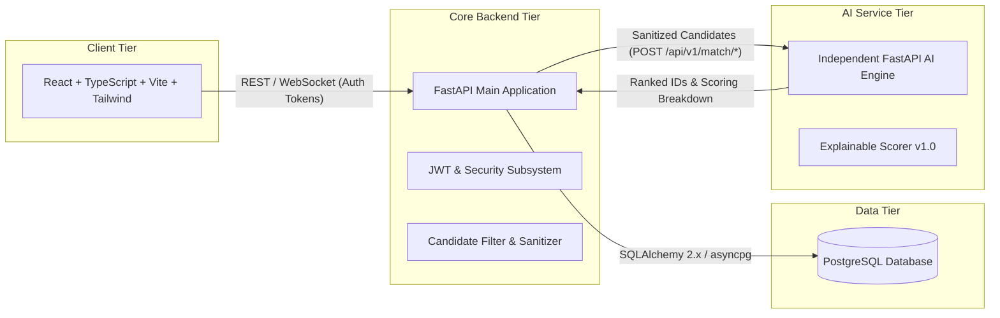

# SocialConnect — Master Architecture & Project Plan

## 1. Product & Architecture Overview

**SocialConnect** is an interest-based friendship and real-world meetup platform (explicitly not a dating app). It enables individuals to connect over shared activities (festivals, sports, travel, food/cafe visits, music concerts, city exploration), coordinate participation, request to join, communicate safely via authorized group messaging, and attend activities together in public spaces.

### Architectural Principles & Boundaries
1. **Frontend Isolation**: React frontend communicates strictly via HTTP/WebSocket with the Main FastAPI Backend. Frontend never speaks directly to PostgreSQL or the AI Service.
2. **Backend Authority**: Main FastAPI Backend owns all authentication, authorization (RBAC), database persistence, candidate pre-filtering, and external service communication.
3. **AI Service Role**: The AI Service is an independent, versioned FastAPI service. It receives sanitized, pre-filtered candidate data from the main backend and performs explainable matching/ranking. It makes **zero** authorization decisions and has no database access.
4. **No-Hardcoding Rule**: No hardcoded test users, fake AI scores, or pseudo-database arrays. Data is persisted in PostgreSQL via SQLAlchemy 2.0 and Alembic.

---

## 2. Phased Execution Roadmap

- [x] **Phase 1: Architecture, ER Design, API Contracts, Safety, AI Design & Documentation**
  - Requirements analysis, product overview, domain constraints.
  - Complete documentation suite:
    1. `architecture.md` (System architecture and repository structure)
    2. `database-design.md` (Database tables, relationships, constraints, ER diagram)
    3. `api-contracts.md` (RESTful v1 API endpoints and request/response specifications)
    4. `security-and-safety.md` (Authentication, privacy, authorization, moderation)
    5. `ai-architecture.md` (Transparent explainable recommendation system design)
    6. `plan.md` (Development phases and decisions)
    7. `handoff.md` (Current progress and next steps)
    8. `README.md` (Project setup and execution documentation)

- [x] **Phase 2: Project Initialization & Service Scaffolding**
  - Backend initialized: FastAPI, SQLAlchemy 2.x, asyncpg, CORS, logging, custom error handlers, `.env.example`, `.env`, `/api/v1/health` and `/api/v1/health/db`.
  - AI Service initialized: FastAPI, NumPy, Pandas, Scikit-learn, deterministic heuristic scorer (`scorer.py`), scoring breakdown schemas, and `/api/v1/match/*` endpoints.
  - Frontend initialized: React, TypeScript, Vite, Tailwind CSS, TanStack Query, Axios client with JWT interceptor, responsive layout with live architecture diagnostic, and honest empty states.
  - All 3 applications scaffolded with verified independent virtual environments and node dependencies.

- [x] **Phase 3: Database Migrations, Authentication & Profile System**
  - Database models implemented: `users`, `user_profiles`, `interests`, `user_interests`, `user_availability`, `activity_categories`.
  - Alembic versioned migration authored: `2026_11_12_0001-create_auth_and_profile_tables.py`.
  - Idempotent reference data seed script authored: `scripts/seed_reference_data.py` (6 categories, 20+ standardized interests).
  - Backend auth endpoints implemented: register, login, refresh, me, deactivate using direct bcrypt & rotating JWTs.
  - Backend onboarding and profile endpoints implemented: age validation (18+), residential address privacy protection, interest graph mapping, and availability slots.
  - Frontend auth & onboarding flow implemented: `AuthProvider`, `ProtectedRoute`, `RegisterPage` (Zod validation), `LoginPage`, 4-step `OnboardingPage` wizard, and `ProfilePage`.
  - Verified with 5/5 passing unit tests and clean TypeScript compilation.

- [x] **Phase 4: Activities, Discovery & Participation System**
  - Database models implemented: `Activity`, `ActivityParticipant`, `JoinRequest` in `app/modules/activities/models.py`.
  - Alembic versioned migration authored: `2026_11_12_0002-create_activities_and_participation_tables.py`.
  - Community safety landmark validator: `app/shared/utils/landmark_verifier.py` prohibiting residential, apartment, or private meeting points.
  - Backend activity CRUD & discovery engine: `POST /activities`, `GET /activities` (search, category filter, city filter, status, pagination), `GET /activities/{id}`, `PUT /activities/{id}`, `POST /activities/{id}/cancel`.
  - Participation & host vetting system: `POST /activities/{id}/requests` (submit join request), `GET /activities/{id}/requests` (host review), `POST /activities/{id}/requests/{req_id}/decision` (host approves/declines), `POST /activities/{id}/leave` (participant withdrawal), capacity auto-update to `FULL`.
  - User activity overview: `GET /activities/my/overview` returning consolidated hosting, joined, and requested items.
  - Frontend integration:
    - `CreateActivityPage.tsx`: category picker, public landmark verification, datetime validations, capacity slider.
    - `DiscoverPage.tsx`: live multi-filter board, category pills, city filter, spots left progress bar, honest empty states.
    - `ActivityDetailPage.tsx`: host profile spotlight, verified public landmark banner, confirmed roster, host request management drawer, join modal.
    - `MyActivitiesPage.tsx`: live dynamic tabs (Hosting, Joined, Submitted Requests) with counts and review shortcuts.
  - Automated testing: 20/20 backend pytest tests passing, 0 TypeScript errors (`tsc --noEmit`), production bundle compiled in 6.38s.

- [x] **Phase 5: Messaging, Notifications & Safety/Moderation**
  - Database models implemented: `Conversation`, `ConversationMember`, `Message`, `Notification`, `UserBlock`, `Report`.
  - Alembic versioned migration authored: `2026_11_12_0003-create_messaging_notifications_and_safety_tables.py`.
  - Real-time WebSocket manager (`websocket_manager.py`) and message service with automatic profanity/harassment filtering.
  - In-app notification engine: `GET /notifications`, unread badge count, mark as read, event hooks triggered upon join request, acceptance, decline, cancellation.
  - Community safety & moderation: bidirectional user blocking, report submission (`POST /safety/report`), automated blocked user query exclusion.
  - Frontend integration:
    - `Navbar.tsx`: live notification bell with unread count badge, animated indicator, dropdown drawer with instant navigation.
    - `MessagesPage.tsx`: full dual-pane group messenger with WebSocket connectivity, auto-scrolling message stream, and system announcements.
    - `ReportModal.tsx`: safety violation reporting modal wired into activity details.

- [x] **Phase 6: AI Explainable Recommendation & Matching Engine**
  - Backend integration client: `app/modules/matching/client.py` communicating with independent AI microservice (`http://localhost:8001/api/v1/match/*`) with circuit breaker fallback.
  - Heuristic scoring endpoints: `GET /api/v1/recommendations/activities` and `GET /api/v1/recommendations/peers` with mathematical breakdown ($0.40 S_i + 0.30 S_s + 0.20 S_l + 0.10 S_c$).
  - Interactive Public Landmark Map: `PublicLandmarkMap.tsx` with geospatial public landmark plotting, safe public meeting shields, and clickable preview popups.
  - Frontend `RecommendationsPage.tsx`:
    - Live AI activity recommendations with compatibility percentages and factor breakdown progress bars.
    - Compatible companions matching with shared interests pills.
    - Interactive factor weight tuning sliders allowing users to dynamically adjust importance of interests, schedule, location, and category in real time.
    - View toggle on `DiscoverPage.tsx` switching seamlessly between Cards Grid and Landmark Map.

- [x] **Phase 7: End-to-End Verification, Automated Tests & Audit**
  - Backend unit & integration test suite: 29/29 tests passed in 3.29s (`pytest tests/`).
  - AI recommendation service test suite: 14/14 tests passed in 1.03s (`pytest tests/`).
  - Alembic database migration offline validation: 3 versioned migrations validated with full transactional SQL generation.
  - Multi-Stop Festival & Outing Itinerary Builder: interactive stop sequence builder with preset trails (Durga Puja, Coffee & Book Crawl, Riverside Photo Walk) and visual timeline connector in `ActivityDetailPage.tsx`.
  - Frontend production build verification: TypeScript check (0 errors) and Vite production bundle compiled in 7.60s.
  - Master test runner (`test-all.ps1`) and multi-process startup script (`start-all.ps1`) authored and verified.

